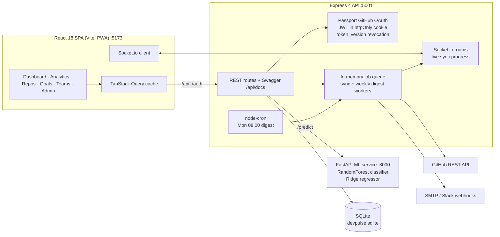

<div align="center">

<a href="https://techmines.github.io/"></a>

# DevPulse

**Developer wellness intelligence — your GitHub history, read for burnout before it happens.**

[](https://github.com/TECHMINEs/devpulse/actions/workflows/ci.yml)


</div>

DevPulse syncs your GitHub repositories and commits, then scores *how* you work: night and weekend coding, sprint-and-crash cycles, streaks and velocity. The result is a 0–100 wellness score with a machine-learning forecast. It surfaces unhealthy patterns through live dashboards, achievements, team views, PDF reports and a weekly digest e-mail, before they turn into burnout.

---

## Architecture



## Tech Stack

- **Frontend:** React 18, Vite 5, Tailwind CSS 3, TanStack Query 5, Zustand, Recharts, Framer Motion, Socket.io client, vite-plugin-pwa
- **Backend:** Node.js 20, Express 4, Passport (GitHub OAuth 2), jsonwebtoken, Socket.io, helmet, express-validator, rate-limiter-flexible, node-cron, Nodemailer, PDFKit, Swagger (OpenAPI 3)
- **ML service:** Python 3.11, FastAPI, scikit-learn (RandomForestClassifier + Ridge), pandas, NumPy, joblib, Pydantic 2
- **Data:** SQLite, with a Postgres-style `$n` parameter layer
- **Tooling:** ESLint, GitHub Actions (frontend lint and build, backend lint, ML training check)

## Local Setup

**Prerequisites:** Node.js 20+, Python 3.11+, and a [GitHub OAuth app](https://github.com/settings/developers) whose callback URL is `http://localhost:5001/auth/github/callback`.

```bash
git clone https://github.com/TECHMINEs/devpulse.git
cd devpulse
```

**1. ML service (http://localhost:8000)**

```bash
cd ml-service
python3 -m venv venv && source venv/bin/activate
pip install -r requirements.txt
python train.py                 # writes model_classifier.pkl and model_regressor.pkl
uvicorn main:app --port 8000
```

**2. Backend API (http://localhost:5001, docs at http://localhost:5001/api/docs)**

```bash
cd backend
npm install
cp .env.example .env            # set GITHUB_CLIENT_ID/SECRET, JWT_SECRET and a 64-hex ENCRYPTION_KEY
npm run db:init                 # applies src/db/schema.sql to ../devpulse.sqlite
npm run dev
```

Generate the secrets with `openssl rand -hex 32`.

**3. Frontend (http://localhost:5173)**

```bash
cd frontend
npm install
cp .env.example .env
npm run dev
```

Open http://localhost:5173 and click **Continue with GitHub**. After onboarding, press **Sync Now** to import your repositories and watch progress stream in live.

## Key Features

- **GitHub OAuth sign-in:** the JWT lives in an httpOnly cookie, and bumping a per-user `token_version` revokes every session server-side.
- **Wellness scoring (0–100):** risk flags are derived from commit timing, weekend ratio, streaks and volume, with a 7-day ML forecast.
- **Real-time sync:** repositories and commits are imported by a background worker that pushes progress over authenticated Socket.io rooms.
- **Analytics:** commit heatmap, hourly activity, language mix, radar profile, benchmark comparison, velocity and code-volume charts.
- **Motivation:** goal tracking and 9 auto-detected achievements, such as Night Owl, Streak and Centurion.
- **Teams and public profiles:** team leaderboards and aggregate wellness, plus shareable `/profile/:username` cards.
- **Weekly digest:** a Monday 08:00 e-mail in a configurable `DIGEST_TIMEZONE`, with optional AI insights and Slack alerts.
- **PDF reports:** weekly and monthly reports with vector bar charts, rendered with no native canvas dependency.
- **Admin panel:** its role is verified server-side before it renders.
- **Command palette (⌘K / Ctrl+K)**, an installable **PWA**, and **Swagger** API documentation.

## Engineering Highlights

- **Encrypted secrets at rest.** GitHub access tokens are stored with AES-256-GCM and are never selected into `req.user`, API responses or data exports.
- **Correct SQL parameter binding.** Postgres-style `$n` placeholders are rewritten to SQLite's numbered `?n`, not a bare `?`. Queries that reuse or reorder parameters therefore bind the right values; the earlier positional mapping had silently updated the wrong rows.
- **Infrastructure-free background processing.** An in-memory queue implements Bull's API: process signatures, job state and progress, retries and graceful drain. Sync and digest workers run with no Redis dependency.
- **Node ↔ Python ML boundary.** The FastAPI service loads its models once at startup and validates features with Pydantic. Its `/health` and `/model-info` endpoints let the API degrade gracefully when the model is offline.
- **Granular data loading.** The dashboard splits its data into independent TanStack Query requests, so one slow endpoint never blanks the whole view.
- **Mobile-first navigation.** A bottom tab bar and an off-canvas sidebar drawer make every feature reachable on a 375 px screen.

## Known Limitations

- **Synthetic training data:** the ML models are trained on 1,000 synthetic samples, so real-world accuracy would improve with anonymised production data.
- **GitHub only:** GitLab sign-in is not implemented.
- **Single process:** the job queue and rate limiter are in-memory, so horizontal scaling needs Redis-backed equivalents.
- **No automated tests:** there are no unit or end-to-end tests yet; CI covers lint, build and model training.

---

<div align="center">

Created by **Pranav Jangid** | [**TECHMINES**](https://github.com/TECHMINEs)

</div>
